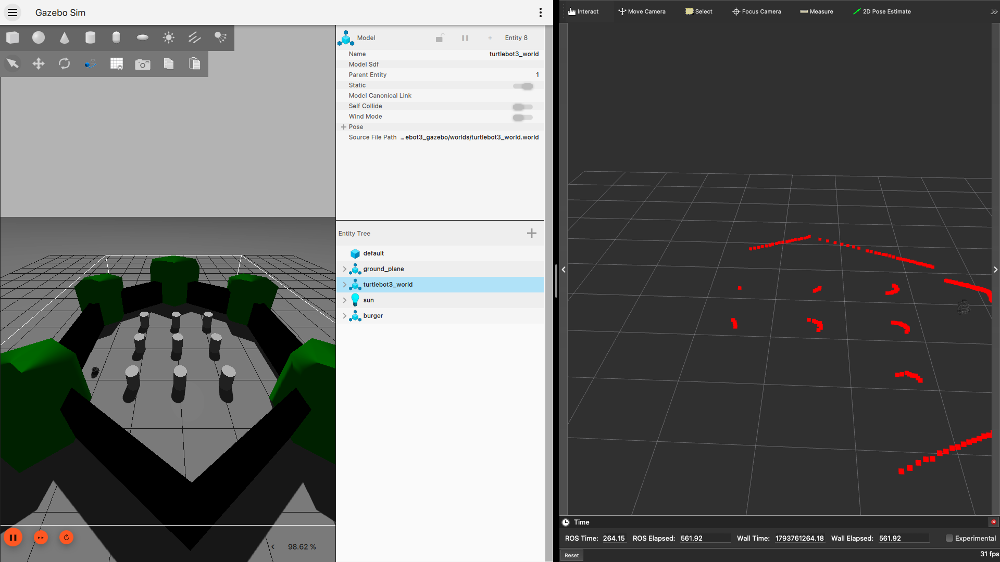

# my_first_robot

A ROS 2 (Jazzy) Python package documenting my path from backend engineering into robotics software. It covers publishers and subscribers, closed-loop control, and lidar-based obstacle avoidance on a simulated TurtleBot3 in Gazebo, all running natively on an Apple Silicon (M1) Mac.

   

## Highlights

- Set up ROS 2 Jazzy, Gazebo Harmonic, and TurtleBot3 natively on macOS ARM64 using RoboStack and Pixi, with a reproducible, version-pinned environment.
- Wrote three ROS 2 nodes, progressing from open-loop commands to closed-loop control using simulated lidar.
- Diagnosed and fixed environment issues along the way, including Gazebo multicast discovery on macOS, QoS mismatches with sensor data, and package manifest errors.

## Nodes

### `lidar_avoider` (TurtleBot3 in Gazebo)
Autonomous obstacle avoidance using a 360° lidar.
- Subscribes to `/scan` (`sensor_msgs/LaserScan`) using sensor-data QoS (Best Effort), and publishes `geometry_msgs/TwistStamped` commands on `/cmd_vel`.
- Takes the minimum distance over angular **sectors** (front ±20°, left, right) rather than single beams, to tolerate sensor noise.
- When blocked, turns toward the more open side and **latches** that direction to prevent oscillation.
- Uses **hysteresis** (starts turning below 0.5 m, resumes driving only above 0.7 m), which eliminated repeated triggers at the threshold. Logs showed bursts of 3–4 triggers per obstacle before the change and a single trigger after.

### `wall_avoider` (turtlesim)
Closed-loop control from position feedback. Subscribes to the turtle's pose, computes the heading error toward the arena center with `atan2`, and steers to reduce it when near a wall (sense → decide → act).

### `move_turtle` (turtlesim)
Open-loop control. Publishes velocity commands on a timer to drive the turtle in an expanding spiral.

## Environment

- macOS (Apple Silicon M1), ROS 2 Jazzy via [RoboStack](https://robostack.github.io/) + [Pixi](https://pixi.sh)
- Gazebo Harmonic, TurtleBot3 (Burger), RViz2
- Key Pixi packages: `ros-jazzy-desktop`, `ros-jazzy-ros-gz`, `ros-jazzy-turtlebot3-gazebo`, `ros-jazzy-turtlebot3-teleop`, `colcon-common-extensions`

## Run

Build (from the workspace root):

    colcon build --packages-select my_first_robot --symlink-install
    source install/setup.zsh

Lidar obstacle avoidance:

    ros2 launch turtlebot3_gazebo turtlebot3_world.launch.py
    ros2 run my_first_robot lidar_avoider

Turtlesim nodes:

    ros2 run turtlesim turtlesim_node
    ros2 run my_first_robot wall_avoider

## Problems solved

| Problem | Cause | Fix |
|---|---|---|
| `source install/setup.bash` failed | zsh can't use bash's self-location logic | Use `setup.zsh` inside `pixi shell` |
| Gazebo: `Exception sending a multicast message: No route to host` | Gazebo's network discovery blocked on macOS | `GZ_IP=127.0.0.1`, set permanently via Pixi `[activation.env]` |
| Lidar data not received | Sensor topics publish with Best Effort QoS | Subscribe with `qos_profile_sensor_data` |
| `Package 'my_first_robot' not found` after build | Duplicate dependency made `package.xml` invalid | Removed the duplicate, clean rebuild |
| Robot re-triggered repeatedly at 0.5 m | Single threshold caused chatter | Added hysteresis (0.5 m / 0.7 m) |

## Learning log

- **Nov 2, 2026:** Installed ROS 2 Jazzy on M1 via RoboStack/Pixi. Built first package; wrote `move_turtle` (publisher) and `wall_avoider` (subscriber with feedback control). Verified Gazebo runs natively at ~98% real-time factor. Spawned TurtleBot3 and read raw lidar data.
- **Nov 3, 2026:** Visualized lidar scans in RViz and observed occlusion. Wrote `lidar_avoider` with sector-based sensing, a latched turn direction, and hysteresis.

## Next

- SLAM with `slam_toolbox` to build and save a map of the TurtleBot3 world
- Autonomous navigation with Nav2 (goal-based path planning on the saved map)
- A C++ (`rclcpp`) version of `lidar_avoider`
- Robotics data pipeline: record runs to MCAP, store metadata in Postgres, inspect in Foxglove, with CI via GitHub Actions